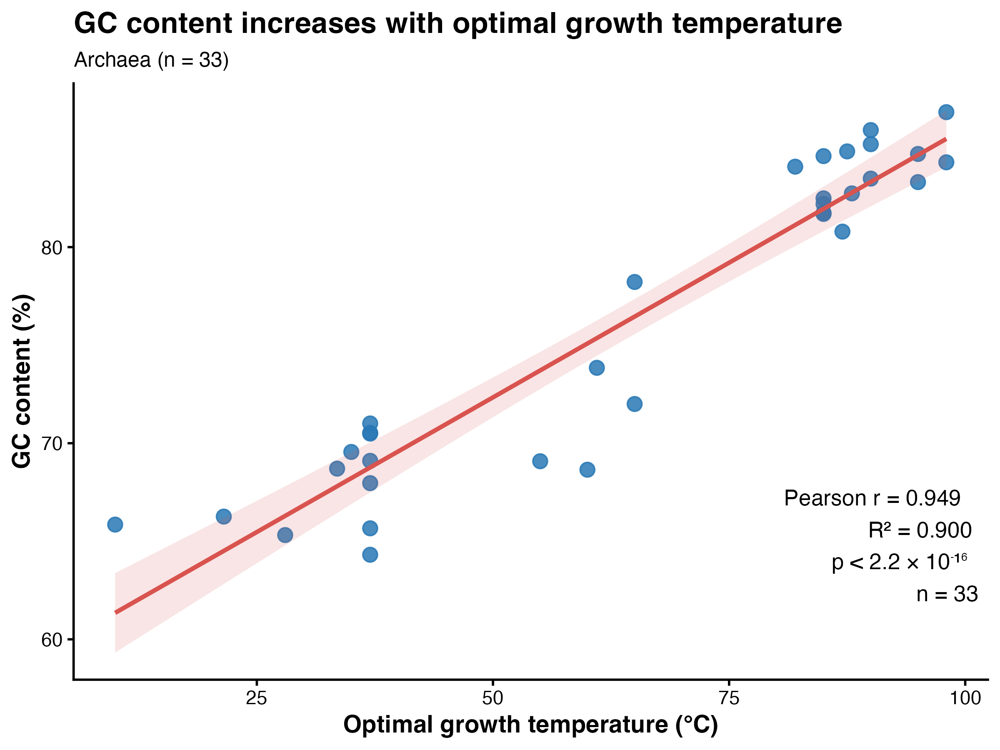

# Corrélation entre la composition du GC de l'ARN ribosomique et la température de croissance dans Archaea.

## 1. Introduction

### 1.1 Contexte
 
Les archées sont des micro-organismes qui vivent à des températures très variées, des milieux tempérés jusqu'à des sources chaudes (de mésophiles ~20°C à hyperthermophiles ~100°C).

Deux signaux moléculaires sont connus pour être corrélés à la température de croissance optimale (OGT) : le %GC de l'ARN ribosomique et la composition en acides aminés des protéines, ce sont des **thermomètres moléculaires**.
On peut donc, en principe, utiliser ces signaux pour reconstruire la température des ancêtres (des organismes qu'on ne peut évidemment plus observer directement).

### 1.2 L'étude de référence : Groussin et Gouy (2011)

- Leur méthode : deux étapes séparées

Les auteurs ont étudié 35 espèces d'archées dont le génome est complètement séquencé, à partir de deux sources d'information : l'ARNr et 72 familles de protéines.

1. **Reconstruire la composition en GC des ancêtres:**
Construisent une phylogénie des Archées (35 génomes), utilisent des modèles non-homogènes d'évolution moléculaire pour reconstruire les séquences ancestrales (ARNr + protéines) à chaque nœud de l'arbre.
2. **Traduire ces compositions en températures:** À partir de ces séquences ancestrales reconstruites, ils calculent le %GC (ou la composition en acides aminés) à chaque nœud.
Chez les espèces actuelles, ils mesurent la relation entre composition et OGT (r = 0,95 pour le GC de l'ARNr, r = 0,84 pour un indice de composition des protéines). Cette  droite de régression GC% ↔ OGT sert de thermomètre : ils y placent les compositions ancestrales pour en déduire la température des ancêtres.

Pour vérifier que ces corrélations ne viennent pas simplement de la parenté entre espèces, ils les recalculent avec des contrastes phylogénétiquement indépendants (PIC), qui confirment le lien.

***Resultat article***: 
- Ils trouvent que l'ancêtre commun des archées était **hyperthermophile** : environ 90 °C d'après l'ARNr et 82 °C d'après les protéines avec un intervalle de confiance de 74-89 °C
- Plusieurs lignées, notamment chez les Euryarchées, se sont ensuite adaptées progressivement à des milieux plus froids.
- Les lignées des milieux tempérés évoluent plus vite (branches plus longues) : la température apparaît comme un déterminant majeur de la vitesse d'évolution moléculaire chez les archées.

Pour une representation de nos données on trouve quil y a une correlation positive entre GC et Temperature pour les especes actuelles de archea. Cette correlation est significative (p < 2,2 × 10⁻¹⁶)



- Corrélation de Pearson : **r = 0,949** (p < 2,2 × 10⁻¹⁶)
- R² de la régression : **0,90**
- Nombre d'espèces : **33**

 
## 2 Problematique

- Leur approche se fait en deux étapes séparées : (1) reconstruction du GC% ancestral par un modèle moléculaire, puis (2) régression post-hoc GC%→OGT.
- Conséquence, l'incertitude de l'étape 1 et celle de l'étape 2 ne sont jamais combinées correctement. On sous-estime probablement l'incertitude réelle sur les températures ancestrales,on obtient donc probablement des intervalles de confiance trop optimistes sur les températures ancestrales.
- De plus, leur régression GC↔OGT est calibrée sur les espèces actuelles uniquement (corrélation "statique"), alors que ce qu'on veut vraiment tester, c'est si GC et température évoluent ensemble le long des branches de l'arbre (corrélation "dynamique"/évolutive). Ce n'est pas rigoureusement la même chose (c'est d'ailleurs pour cette raison qu'ils utilisent en renfort les contrastes indépendants de Felsenstein, PIC, mais toujours dans une étape séparée).


## 3 Objectifs

Ce projet a deux objectifs, qui s'enchaînent :

1. **Modéliser l'évolution corrélée de la teneur en GC de l'ARNr et de la température de croissance à travers Archaea en tenant compte de l'inertie phylogénétique.**
   Quand la température optimale de croissance (OGT) d'une lignée augmente au cours de l'évolution, son taux de GC augmente-t-il aussi ? Cette corrélation est mesurée par un paramètre du modèle, `beta`.

2. **Utiliser cette corrélation pour inférer les températures ancestrales aux nœuds internes de l'arbre, notamment à l'ancêtre commun des Archées.**
   La racine de l'arbre représente l'ancêtre commun des espèces étudiées : vivait-il dans un milieu chaud ou froid ?


## 4. **Materiel et méthodes**

### 4-1 Données

L'analyse porte sur 33 espèces d'archées. Le dossier `data/` contient :

| Fichier | Contenu |
| --- | --- |
| `data/archaea.nex` | Alignement de l'ARNr : 1 801 positions des régions en double brin, dont la composition est la plus liée à la température |
| `data/archaea.tree` | Arbre phylogénétique des 33 espèces (topologie et longueurs de branches, considérées comme fixes) |
| `data/archaea_temp_gc.nex` | Température optimale de croissance (OGT) et taux de GC de l'ARNr de chaque espèce actuelle |
| `data/rna.itgc` | Fichier de GC de tous les noeuds internes de l'arbre y compris celui de la racine |


### 4.2 Methodologie de notre modele 

Nous reprenons la même question avec l'ARNr, mais en remplaçant les deux étapes par un seul modèle bayésien, implémenté dans RevBayes.

| Limite de l'approche de l'article | Ce que notre modèle apporte |
|---|---|
| **Analyse en deux étapes** : Reconstruction de séquences ancestrales à chaque nœud (via bppAncestor), à partir desquelles on calcule la composition GC/acides aminés ancestrale. Cette composition est projetée sur la relation composition OGT et GC établie empiriquement sur les espèces actuelles, pour inférer l’OGT ancestrale à chaque nœud. Ils utilisent aussi les contrastes phylogénétiques indépendants (PIC) pour éviter le biais lié au fait que les espèces ne sont pas des observations statistiquement indépendantes (ancêtre commun). | **Estimation simultanée** : la corrélation \(beta\), les compositions en GC ancestrales et les températures ancestrales sont estimées conjointement dans **un seul modèle bayésien**. |
| **L'incertitude de la relation GC–température n'est pas propagée** jusqu'à l'estimation des températures ancestrales. | L'approche bayésienne **propage l'incertitude de tous les paramètres** dans la distribution a posteriori. Les intervalles de crédibilité des températures ancestrales tiennent donc compte simultanément de l'incertitude sur \(\beta\), le GC et les autres paramètres du modèle. |
| **Les espèces sont traitées comme des observations indépendantes** dans la régression du GC-Temperature. | La relation entre GC et température est modélisée **le long des branches de l'arbre**. Les espèces apparentées partagent donc une histoire évolutive commune, et cette dépendance phylogénétique est directement prise en compte. |
| **La température est essentiellement considérée comme une variable à expliquer à partir des observations actuelles.** | La température est elle-même **modélisée comme un caractère évolutif qui varie le long de l'arbre**. Les températures actuelles fournissent ainsi de l'information pour estimer les températures des ancêtres.

### 4.3 Le principe du modèle : 
Nous sommes partir du principe selon lequel les espèces phylogénétiquement proches tendent à présenter des caracteristique (ex : températures optimales de croissance) similaires. Cette similarité peut s'expliquer en partie par l'héritage de caractéristiques communes provenant de leur ancêtre commun, ce qui traduit une inertie phylogénétique. 
Le modele browinien traduit cette intuition biologique et dit que les variations d'une variable le long des branches de l'arbre phylogénétique sont supposées suivre une distribution normale, de moyenne la valeur de la variable au noeud parent et de variance proportionnelle à la longueur des branches et plus la branche est longue, plus la dispersion est grande.

On a donc  : 
- **La température** :
```
log T(i)    ~ Normale( log T(pa(i)),  sigma_T × √bl(i) )
```
`sigma_T`: contrôle la vitesse de dérive de la température, indépendamment du GC%. 
 
- **La taux de GC** :
Il a été établir qu'un lien entre composition en GC et température existe : les structures secondaires de l’ARN riches en GC sont thermodynamiquement plus stables à haute température (littérature). Les données de Groussin & Gouy, 2011 le confirment, avec une corrélation de Pearson de r = 0,95 entre le GC% de l’ARNr et la température optimale de croissance.
Pour alors estimer la force exacte de ce lien, nous avons effectué une regression linéaire de la temperature sur le taux GC par le biais de beta.
Ainsi  :
- beta > 0 : quand une lignée se réchauffe (log T augmente le long d’une branche), son GC% a tendance à augmenter en même temps.
- beta < 0 : relation inverse — irait à l’encontre de la littérature.
- beta ≈ 0 (intervalle de crédibilité à 95% contenant 0) : pas de preuve statistique de corrélation évolutive entre les deux caractères, une fois l’inertie phylogénétique prise en compte.
```
logit GC(i) ~ Normale( logit GC(pa(i)) + beta × [log T(i) - log T(pa(i))],  sigma_GC × √bl(i) )
```
```changement de GC ≈ beta × changement de température + variation propre au GC``


Aux extrémités de l'arbre, la température et le GC des espèces actuelles sont connus. À partir de ces observations, le modèle estime `beta` et les valeurs ancestrales, chacune avec son incertitude (distribution a posteriori).

<details>
<summary><b>Détails techniques du modèle</b></summary>

- La température est modélisée en logarithme (elle reste positive) et le GC en logit (il reste entre 0 et 1) : ce sont deux mouvements browniens le long de l'arbre, couplés par `beta`.
- Lois a priori : `sigma_T` et `sigma_GC` suivent une exponentielle de taux 1 ; `beta` ~ Normale(0, 5) ; log T à la racine ~ Normale(ln 75, 10) ; logit GC à la racine ~ Normale(0, 10).
- Inférence par MCMC : 100 000 générations, un échantillon toutes les 10 générations.

</details>

## 5. Analyses réalisées

Les analyses ont été menées dans cet ordre :

1. **Vérification sans arbre.** Corrélation de Pearson et régression linéaire entre GC et OGT chez les 33 espèces actuelles, pour vérifier que nos données contiennent le signal attendu.

2. **Modèle complet** (`archaea_simple.Rev`). Tout est estimé : `beta` (objectif 1) et la température de la racine (objectif 2).
3. **Deux analyses de contrôle**, pour comprendre comment l'information sur le GC atteint la température :
   - GC de la racine fixé à environ 85,9 % (`archaea_simpleRoot.Rev`) ;
   - GC de la racine fixé et `beta = 0`, c'est-à-dire sans lien entre GC et température (`archaea_GCRoot_β0.Rev`).

Chaque analyse MCMC produit 10 001 échantillons (fichiers `analyses/*.log`). Les 10 % premiers sont écartés (burn-in). Les résultats sont résumés par la moyenne a posteriori et l'intervalle de crédibilité à 95 % (quantiles 2,5 % et 97,5 %).


## 6. Résultats

### 6.1 Objectif 1 : la corrélation entre GC et température

Avec le modèle complet :

- `beta` : moyenne **0,49**, intervalle de crédibilité à 95 % **[0,32 ; 0,67]** (ESS = 1 668) ;
- l'intervalle exclut 0 : `beta` est positif.

Quand la température d'une lignée augmente au cours de l'évolution, son taux de GC tend donc lui aussi à augmenter. Ce résultat confirme celui de Groussin et Gouy (2011).

Les vitesses d'évolution estimées sont `sigma_T` = **0,68** (température) et `sigma_GC` = **0,32** (part de variation du GC non expliquée par la température).


### 6.2 Objectif 2 : la température de la racine

| Analyse | GC de la racine | `beta` | Température de la racine (IC 95 %) |
| --- | --- | --- | ---: |
| Modèle complet | estimé : **80,4 %** [76 ; 85] | estimé : 0,49 | **71,9 °C** [45,5 ; 102,2] |
| Contrôle 1 | imposé à 85,9 % | estimé : 0,55 | **107,0 °C** [78,1 ; 139,0] |
| Contrôle 2 | imposé à 85,9 % | fixé à 0 | **72,8 °C** [46,1 ; 102,5] |

**Résultat principal.** Avec le modèle complet, la température de l'ancêtre commun est estimée à environ 72 °C : un ancêtre thermophile, avec une incertitude large : entre 45 et 102 °C (intervalle à 95 %). Cet intervalle exclut un ancêtre mésophile (moins de 40 °C environ) et contient les estimations de Groussin et Gouy (90 °C avec l'ARNr, 82 °C avec les protéines) : les deux approches concluent à un ancêtre chaud. Notre estimation centrale est plus basse que celles de l'article, mais l'intervalle ne permet pas de trancher entre thermophile et hyperthermophile (seuil de 80 °C dans l'article).

**Contrôles.** Imposer le GC de la racine à 85,9 %, une valeur plus élevée que celle estimée par le modèle (80,4 %), fait monter la température de la racine à environ 107 °C, alors que `beta` reste du même ordre (0,55 contre 0,49) : l'information sur le GC passe donc vers la température. Si l'on supprime en plus le lien (`beta = 0`), le GC ne renseigne plus sur la température, qui n'est plus estimée qu'à partir des températures actuelles : environ 73 °C, soit la valeur du modèle complet. C'est donc `beta` qui permet au GC de renseigner la température.

Ces écarts sont à lire avec prudence : les intervalles des trois analyses se chevauchent largement. Ils montrent surtout que la reconstruction est sensible à ce que l'on impose à la racine.

## 7. Conclusion

Oui, il est possible d'estimer dans un seul modèle à la fois la corrélation évolutive entre GC et température et la température des ancêtres :

1. **Le GC de l'ARNr et la température ont évolué ensemble chez les archées** : `beta` est positif (0,49, intervalle de crédibilité à 95 % [0,32 ; 0,67]).
2. **Cette corrélation permet d'estimer la température de l'ancêtre commun** : environ 72 °C, un ancêtre thermophile, avec un intervalle à 95 % de 45 à 102 °C. Cela rejoint la conclusion de Groussin et Gouy d'une origine chaude des archées, obtenue ici par une méthode différente, mais l'incertitude ne permet pas de distinguer un ancêtre thermophile d'un ancêtre hyperthermophile. En imposant le GC connu de la racine, l'estimation monte à environ 107 °C, avec un intervalle plus haut et toujours large.
3. **`beta` est le lien qui relie les deux caractères** : sans lui (`beta = 0`), le GC n'apporte plus d'information sur la température, qui retombe à environ 73 °C malgré le GC connu.


## Références

Groussin M., Gouy M. (2011). Adaptation to Environmental Temperature Is a Major Determinant of Molecular Evolutionary Rates in Archaea. *Molecular Biology and Evolution*, 28(9), 2661-2674. https://doi.org/10.1093/molbev/msr098

Boussau B., Blanquart S., Necsulea A., Lartillot N., Gouy M. (2008). Parallel adaptations to high temperatures in the Archaean eon. *Nature*, 456, 942-945.
